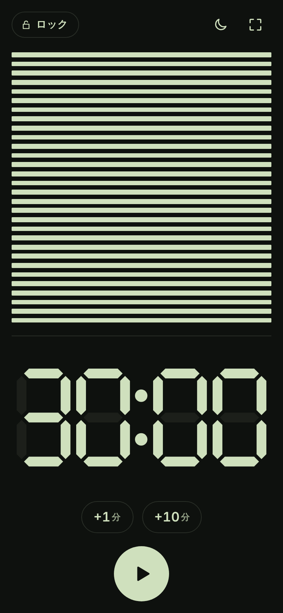

# Thirty

Thirtyは、作業を始めるきっかけを作るための、小さなiOSタイマーです。
SNSを眺めているうちに時間が過ぎたり、何から始めるかを考え込んだりしたときに、先にタイマーを押して、その時間だけひとつの作業に取りかかる使い方を想定しています。
初期値は30分なので、最初は再生ボタンだけで始められます。

黒い棒と液晶数字が並ぶ物理タイマー（ビジュアルバータイマー）を参考にしています。
v0.3.0からは、アプリの中にタイマーの絵を置くのではなく、スマホの画面全体を液晶にして、スマホそのものをタイマーとして使う設計です。
縦向きでは上に30本の棒、下に残り時間を表示し、横向きでは物理タイマーと同じく左に棒、右に数字を並べます。
計測中は4秒触らないと操作ボタンが消え、棒と数字だけになります。画面をタップすると戻ります。

| 縦向き | 横向き | 暗い配色 |
| --- | --- | --- |
|  |  |  |

画像はブラウザの画面プレビューです。
v0.3.0は、GitHub ActionsのmacOSでビルドとSimulatorでの撮影を行っています。実機での動作はまだ確認していません。
IPAやApp Store配布はありません。

## 操作

| 操作 | 動作 |
| --- | --- |
| ▶ | 開始、または一時停止から再開 |
| ⏸ | 一時停止。数字がゆっくり点滅する |
| ■ | 終了し、最後に設定した時間へ戻る |
| 液晶の数字をタップ | 5〜120分のプリセット、または分と秒を選ぶ。範囲は00:00〜999:59 |
| +1分 / +10分 | 残り時間を追加する。計測中も使用可能 |
| 月のアイコン | タップで計測中の減光を切替。長押しで「画面を消さない」と通知設定 |
| 回転のアイコン（iPhone） | 動画アプリのように横向き／縦向きへ切り替える。端末を同じ向きにすると自動回転に戻る |
| ロック | アクセスガイドの設定手順を開く。実行中は「ロック中」と表示 |
| パレットのアイコン | スキンを選ぶ。クラシック以外は Thirty+（買い切り）で使える |

00:00では開始ボタンを無効にします。
黒い棒30本は、設定時間に対する残り時間の割合を表します。縦向きでは上から、横向きでは右から減ります。
終了すると00:00が点滅します。
終了時刻を保存し、アプリを閉じたあとも、戻った時点の残り時間を計算します。

終了音は、アプリを開いている間は同梱の音源を再生し、背景では許可済みのローカル通知を使う設計です。
背景の音はiOSの通知、消音、集中モードの設定に従います。
減光は元の明るさを保存して行い、終了、停止、アプリを離れるときに復元する実装です。

タイマーの動作にサーバー通信は使いません。
アカウント、広告、外部のAIモデルは不要です。
追加のスキンは買い切りの Thirty+ で、購入と復元のときだけApp Storeと通信します。
Appleの説明ページを開く操作だけはブラウザを使用します。

## アクセスガイドとの組み合わせ

iOS標準のアクセスガイドを手動で開始すると、操作をThirtyの画面に固定できます。
初回の案内は、アプリの紹介1枚と、任意の設定手順3枚です。
紹介の画面から「すぐに始める」で設定を飛ばせます。あとから画面左上の「ロック」で手順だけを開けます。

1. 設定 → アクセシビリティ → アクセスガイドをオンにする。
2. 必要なら、パスコード設定でFace IDまたはTouch IDをオンにする。
3. Thirtyに戻り、サイド、トップ、ホームの該当ボタンを3回連続で押す。

計測開始後は、該当する物理ボタンの側に「×3」の案内を出します。
現在アクセスガイドが実行中であることを検知したら、案内を消します。
設定画面のスイッチのオン／オフを判定したり、アプリから設定をオンにしたりする機能はありません。
タイマー終了後もアクセスガイドは手動で解除します。

端末ごとの操作と公開APIの制約は、[iOSの制約](docs/ios-capabilities.md)にまとめています。

## Windowsでプレビューを開く

Python 3を用意し、`Start-Preview.cmd` を開きます。
または、リポジトリのルートで次を実行します。

```sh
python scripts/serve.py
```

プレビューの回転アイコンは、縦長のブラウザで横向きの画面を擬似的に表示します。
ローカルサーバーは `127.0.0.1` に接続し、ブラウザを開きます。
終了はコンソールでCtrl+Cです。
プレビューはSwiftUI版とは別実装で、月のアイコンもCSSで表示を暗くする近似です。
iOS通知、実際の画面輝度、アクセスガイドは操作しません。

## iOS用ソースをビルドする

SwiftUIを使ったiOS 16以降のアプリで、iPhoneとiPad、縦向きと横向きを対象にしています。
アプリ本体に外部ライブラリの依存はありません。
MacにXcodeと[XcodeGen](https://github.com/yonaskolb/XcodeGen)を用意して実行します。

```sh
cd ios
xcodegen generate
swift test
xcodebuild -project Thirty.xcodeproj -scheme Thirty -configuration Release \
  -sdk iphoneos -destination 'generic/platform=iOS' \
  -derivedDataPath ../build CODE_SIGNING_ALLOWED=NO build
cd ..
python3 scripts/package_ipa.py \
  build/Build/Products/Release-iphoneos/Thirty.app \
  build/Thirty-0.2.0-AltStore.ipa
```

生成されるIPAは未署名です。
AltStoreなどで別途署名する想定で、表示名はASCIIの `Thirty`、Bundle IDは `jp.mugilab.thirty` にしています。
[GitHub Actionsのビルド定義](.github/workflows/ios.yml)は、手動実行と `claude/` で始まるブランチへのPush（`ios/` の変更時）で起動します。
macOS 15のランナーで、`swift test`、実機向けの未署名ビルドとIPA作成、SimulatorでのUIテストとスクリーンショット撮影（明るい配色と暗い配色）を行い、成果物として保存します。

## 要望と実装の記録

- [これまでの要望と実装](docs/requirements-and-implementation.md)
- [コードの構成と状態管理](docs/architecture.md)
- [画面の設計](docs/design.md)
- [iOSでできることと制約](docs/ios-capabilities.md)
- [検証結果と再実行方法](docs/verification.md)
- [収益化（Thirty+）](docs/monetization.md)
