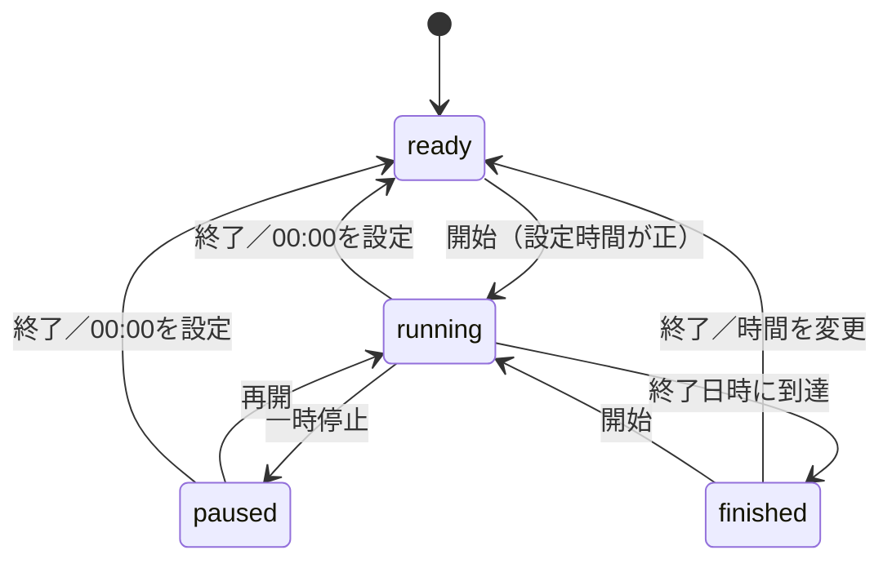

# コードの構成と状態管理

## iOS本体とプレビュー

iOS本体はSwiftUIとAppleの標準フレームワークで実装しています。
ブラウザのプレビューはHTML、CSS、JavaScriptによる別実装で、同じ操作と見た目をWindowsで確認するために用意しています。
両者の保存データは共有されません。

| ファイル | 役割 |
| --- | --- |
| [ThirtyApp.swift](../ios/Thirty/ThirtyApp.swift) | アプリの起動と通知delegate。前景の通知からの二重発音を避ける |
| [Countdown.swift](../ios/Thirty/Countdown.swift) | 時間の計算、4つの状態、時間変更、保存用データ |
| [TimerModel.swift](../ios/Thirty/TimerModel.swift) | SwiftUIへの状態公開、UserDefaultsへの保存、通知予約、ライフサイクル |
| [TimerView.swift](../ios/Thirty/TimerView.swift) | 全画面の液晶、縦横のレイアウト、操作の自動非表示、時間のPicker、ボタン位置の案内 |
| [Orientation.swift](../ios/Thirty/Orientation.swift) | 回転ボタンによる向きの固定と、端末を同じ向きにしたときの解除 |
| [GuideView.swift](../ios/Thirty/GuideView.swift) | 紹介と3段階の設定案内、設定アプリ風の図、ボタンを押すアニメーション |
| [TimerEffects.swift](../ios/Thirty/TimerEffects.swift) | 音の再生、輝度の保存と復元、物理ボタンの種類の推定 |
| [preview/](../preview/) | ブラウザで操作できる独立した画面プレビュー |
| [project.yml](../ios/project.yml) | XcodeGenによるiOSプロジェクトの生成設定 |

## タイマーの4つの状態

`Countdown` は `ready`、`running`、`paused`、`finished` を持ちます。
開始時に終了日時を作り、一時停止時に残り時間を保存します。
終了ボタンは設定時間を消さずに待機へ戻します。



計測中の残り時間は、終了日時から現在日時を引いて計算します。
iOSがアプリを背景で停止しても、表示用タイマーの呼び出し回数が残り時間を左右しないようにしています。
表示は0.5秒ごとに更新し、保存は開始、一時停止、再開、時間変更、終了などの状態変更時に行います。

```text
残り秒数 = ceil(max(0, min(設定秒数, 終了日時 - 現在日時)))
表示する棒 = ceil(残り時間 / 設定時間 × 30)　（Countdown.slats）
```

設定時間は0〜59999秒（999:59）です。100分以上は分を3桁で表示します。
設定時間が0の場合は、棒を0本とし、開始を受け付けません。
保存された初版のデータに設定秒数がない場合は、30分として読み込みます。
端末の日時が手動で変更された場合は、保存した終了日時に対する残り時間も変わります。

## 終了音と背景通知

前景で `running` から `finished` へ変わると、同梱の `alarm.wav` をAVAudioPlayerで再生します。
波形は [create_alarm.py](../scripts/create_alarm.py) で生成した2.4秒のモノラルPCM音源です。
通知の許可がない場合も、前景の再生は同じ処理で行います。

背景では、終了日時に合わせたローカル通知を予約します。
前景に通知が届いた場合はdelegateで通知側の音を抑え、モデルの状態更新へ渡すため、アプリの音と重複させない構成です。
時間切れ後に背景から復帰する際は、音をもう一度鳴らさずに終了状態へ更新します。

通知の認可や登録は非同期なので、各操作にリビジョンを付けて古い結果を無視します。
予約にも固有のIDを使い、古い登録が遅れて完了した場合はそのIDだけを取消します。
一時停止、終了、時間変更では既存の予約を解除し、現在の状態に合わせて更新します。

## 明るさと画面消灯

減光は `UIScreen.main.brightness` の変更で行います。
変更前の値を保存し、計測中または一時停止中で、アプリが前景にあり、月アイコンの設定がオンの場合に適用します。
値は元の輝度と0.12の小さい方とし、暗い画面を逆に明るくしないようにしています。

終了、一時停止からの終了、月アイコンのオフ、前景からの移動では保存値を復元します。
計測中の自動消灯を避ける設定は `isIdleTimerDisabled` で制御し、背景や一時停止では解除します。
iOS全体の低電力モードは操作しません。

## アクセスガイドの案内

現在の実行状態はUIKitから読み取り、開始と終了の通知で更新します。
実行中の検知は「×3」の案内を消すために使い、設定画面のスイッチの判定には使いません。

物理ボタンの種類は、iPhoneかiPadかと、下部のセーフエリアからホームインジケータの有無を推定して選びます。
案内の位置は画面端に置き、画面の向きに応じて移動する実装です。
正確なボタン座標や全機種での適切な表示を実機で検証したわけではありません。

## 画面の向き

iPhoneの回転ボタンは、`requestGeometryUpdate` で横向き（または縦向き）を要求し、`supportedInterfaceOrientationsFor` が返す向きを一時的に固定します。
端末の物理的な向きが固定した向きと一致したら、固定を外して通常の自動回転に戻します。動画アプリの全画面ボタンと同じ考え方です。
iPadはウィンドウの大きさが変わるため、回転ボタンを出さずOSの回転に任せます。
