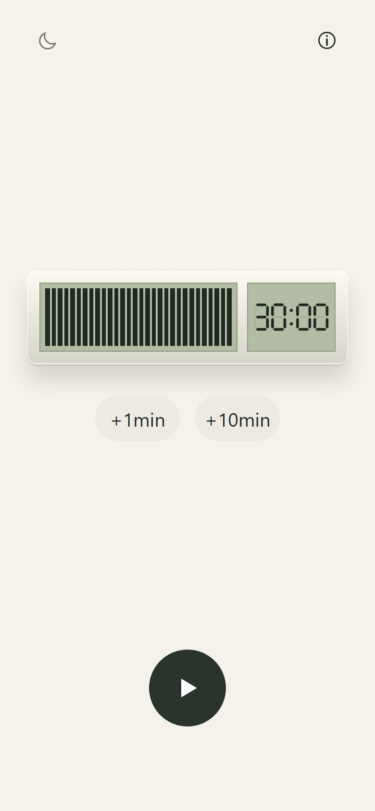
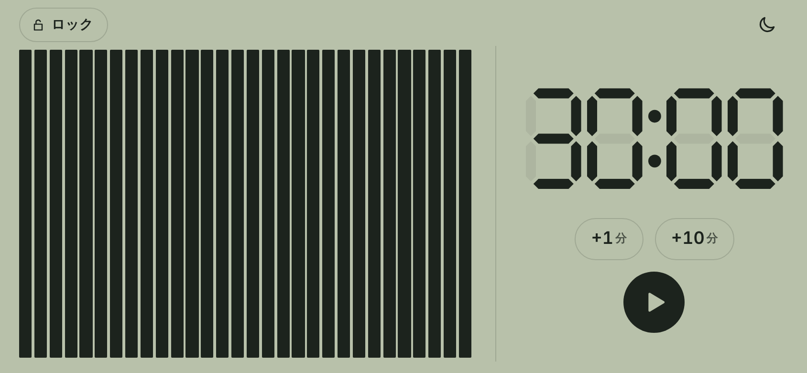
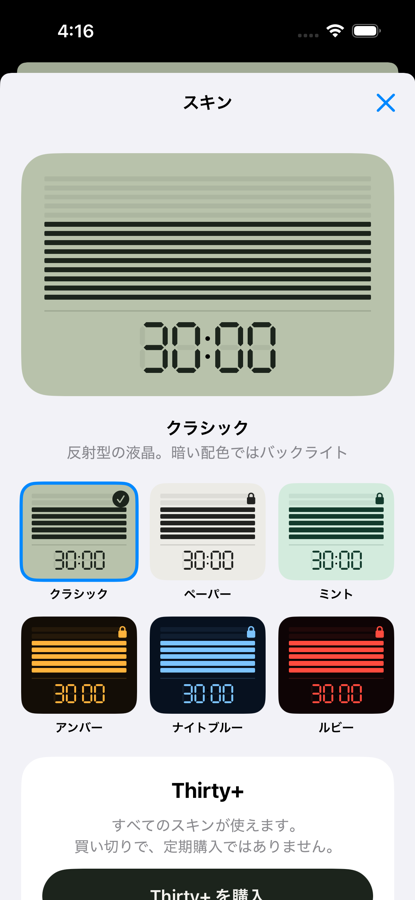
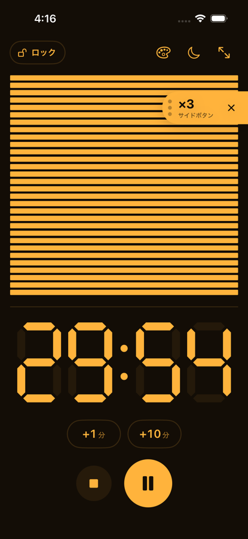
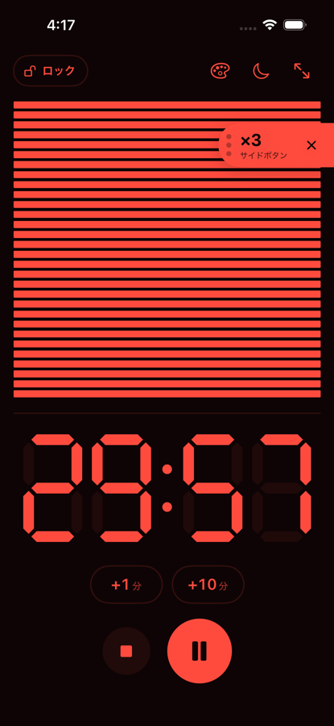
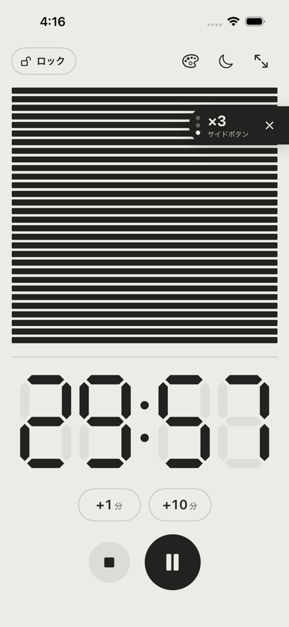
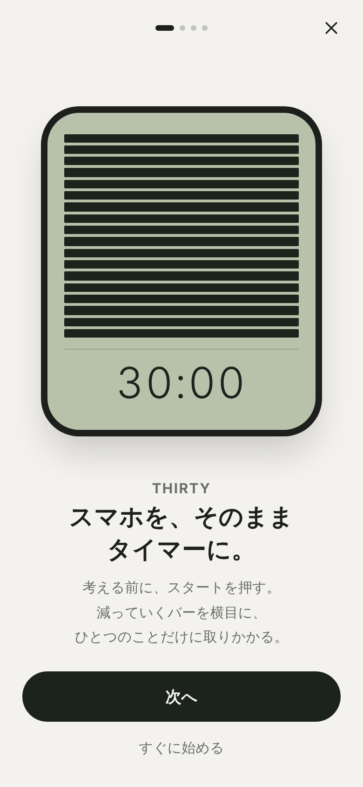
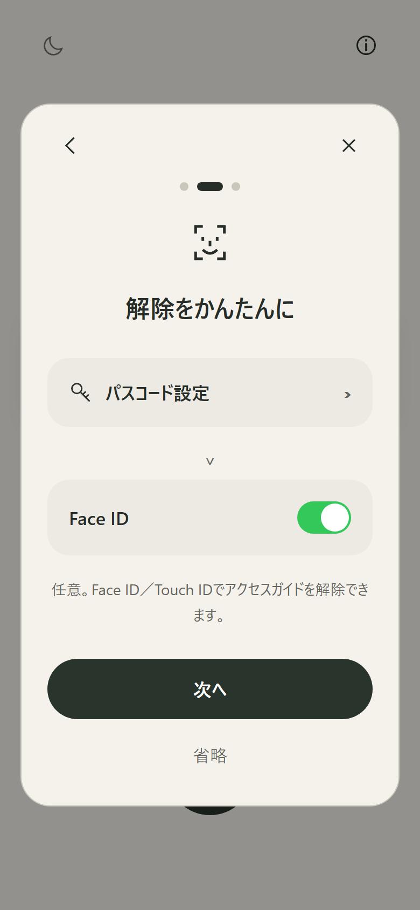
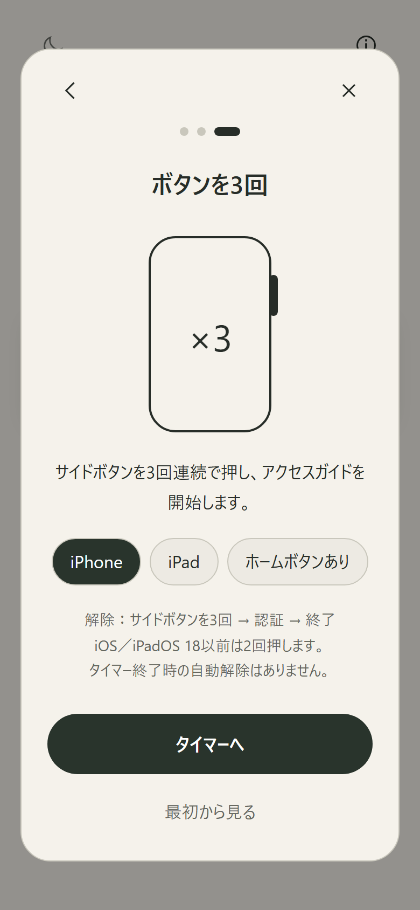
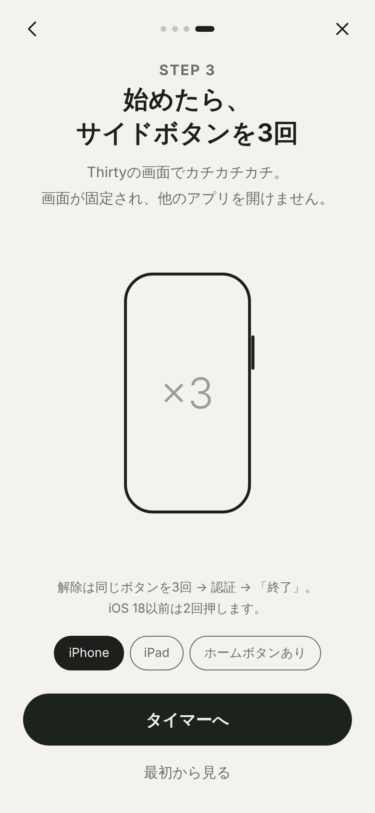

# 画面の設計

## スマホそのものがタイマー

v0.2.0までは、白いケースに入った物理タイマーの絵を画面の中央に置いていました。
v0.3.0では画面全体を液晶にし、スマホの本体がタイマーのケースになる表現に変えました。
アプリの中に製品があるのではなく、手に持っているものがビジュアルバータイマーになる、という見え方を狙っています。

- 明るい配色は、灰緑の反射型液晶と黒い表示です。暗い配色は、黒地に淡い緑が光るバックライト付きの液晶です。
- 7セグメントの数字と棒は、消えている部分もうっすら残します。本物の液晶らしさと、残りの量の比較のためです。
- 終了すると00:00が点滅し、一時停止中はゆっくり点滅します。動きを減らす設定では点滅しません。

| 縦向き | 横向き |
| --- | --- |
|  |  |

## スキン

上部のパレットのアイコンでスキンを選べます。クラシックは無料で、OSの明るい／暗い配色に合わせて反射型とバックライトを切り替えます。
ほかの5種類（ペーパー、ミント、アンバー、ナイトブルー、ルビー）は Thirty+ で使える固定の配色で、ステータスバーもスキンに合わせます。
購入前でもタップすると大きなサンプルで試着でき、使用中の画面は変わりません。

| スキン選択 | アンバー | ルビー | ペーパー |
| --- | --- | --- | --- |
|  |  |  |  |

## 縦と横のレイアウト

縦向きは、上段に棒、下段に数字と操作を置きます。棒は横線を積み重ね、上から減っていきます。
横向きは物理タイマーと同じ配置で、左に縦線の棒、右に数字と操作を置き、右から減ります。
横向きの画面をそのまま縦に回すと縦向きの棒になるため、どちらの向きでも同じ減り方として読めます。

iPhoneでは右上の回転アイコンで、動画アプリの全画面ボタンのように横向きにできます。
横向きでは縦向きに戻すアイコンになります。端末を実際にその向きへ回すと、固定を外して通常の自動回転に戻ります。

## 操作が消える計測中

計測中に4秒触らないと、上部のアイコンと下部の操作が消え、ステータスバーとホームインジケータも隠します。
画面のどこかをタップすると戻ります。VoiceOverの使用中は消しません。
数字はいつでもタップでき、プリセット（5、15、25、30、45、60、90、120分）か、分と秒のホイールで時間を変えられます。

## アクセスガイドの案内

画面左上に「ロック」のチップを常に置きます。実行中でないときは鍵の開いたアイコン、実行中は塗りつぶした「ロック中」になります。
タップすると設定手順の3枚を開きます。
計測を始めた直後で、アクセスガイドが実行中でないときは、該当する物理ボタンの位置に画面の端から「×3」のタブを出し、3つの点を順に光らせます。
実行中になったら消え、×で閉じることもできます。

アプリから設定アプリのアクセスガイドのスイッチを読み取ったりオンにしたりはできないため、案内は「実行中かどうか」だけで出し分けます。

## オンボーディング

初回は4枚です。1枚目でアプリの使い方を見せ、2〜4枚目はアクセスガイドの任意の設定です。
1枚目の「すぐに始める」と2枚目の「あとで設定する」で、いつでもタイマーに進めます。

| 紹介 | 設定をオン | Face ID（任意） | ボタンを3回 |
| --- | --- | --- | --- |
|  |  |  |  |

- 紹介では、小さなスマホの中で棒が減るアニメーションを見せ、文章より先に使い方が伝わるようにしました。
- 設定の図は、iOSの設定アプリの見た目（角の丸いカードと緑のスイッチ）に合わせ、探す行を青い枠で示します。スイッチは表示後にオンへ動きます。図なので、押しても設定は変わりません。
- 3枚目はボタンが3回押され「×1、×2、×3」と数えるアニメーションです。解除の方法と、タイマーが終わっても自動では外れないことを添えます。
- ページは左右のスワイプでも移動できます。

画像はブラウザプレビューです。3枚目の端末切替はプレビュー用で、iOS版は端末に応じて自動で案内を選びます。
