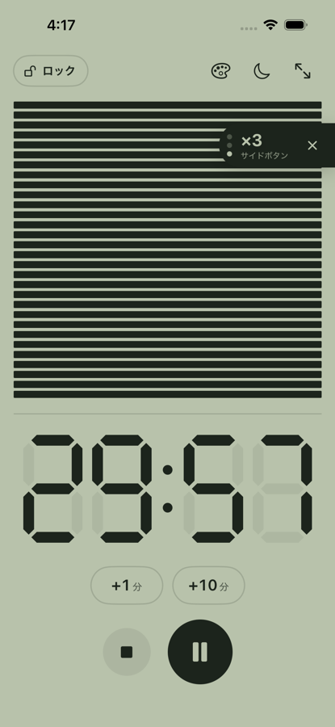
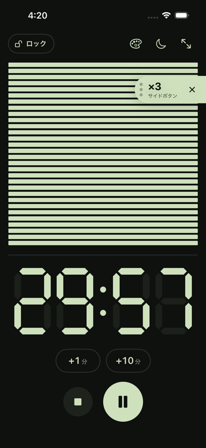
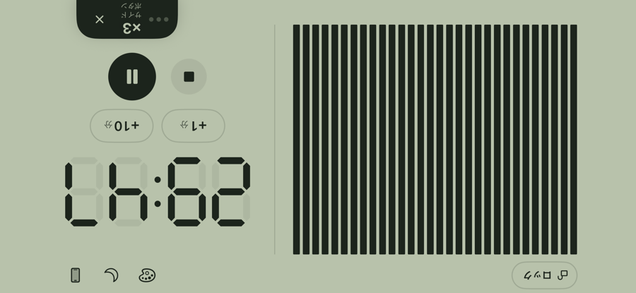

# 検証結果と再実行方法

## 現在の確認範囲

v0.3.0は、iOS本体のソースと、Windowsで操作できるブラウザプレビューを用意した段階です。
GitHubへの公開はソースと文書の公開であり、iOSのビルドや動作確認の成功を意味しません。
GitHub Actionsは手動実行専用で、今回のPushでMacビルドを起動する構成ではありません。

| 対象 | 状態 |
| --- | --- |
| ブラウザの操作、時間の範囲、保存と復元 | Windows Chromiumで確認済み |
| ブラウザの終了音 | WAVの再生イベントが1回だけ発生することを確認 |
| ブラウザの暗い表示 | CSSの近似で確認済み。端末の輝度変更ではない |
| 初回と「ロック」からの案内、端末別の案内のプレビュー | 確認済み |
| WAVの形式と長さ、iOS用とプレビュー用の同一性 | 2.4秒のモノラル16bit PCMを確認 |
| Pythonの構文、JavaScriptの構文、設定ファイル | 確認済み |
| Swiftの時間管理テスト（macOS） | GitHub Actionsで10件成功 |
| iOSのコンパイルと未署名IPA | GitHub ActionsのmacOS 15で成功 |
| SimulatorのUIテスト3件と撮影 | 明るい配色と暗い配色で成功 |
| VoiceOver、Dynamic Type | 未実施 |
| 実機の音、通知、減光と復元、アクセスガイド | 未確認 |
| 実機のホームボタン判定と案内位置 | 未確認 |

## ブラウザで確認した動作

操作を自動化したスクリプトは、[tests/preview_smoke.py](../tests/preview_smoke.py)です。
公開した結果は、[preview-v0.3.json](verification/preview-v0.3.json)に保存しています。

- 初回に紹介と設定手順の4枚を表示し、閉じた記録を保つ。「ロック」から設定手順の3枚を再表示できる。
- メイン画面には「ロック」以外の文章がなく、数字と操作だけを表示する。
- 計測中は4秒で操作が消え、タップで戻る。
- 回転アイコンで横向きのレイアウトになり、もう一度押すと戻る。
- 00:00では開始しない。999:59を超える追加は上限に収める。120:00を3桁で表示し、プリセットで45:00を選べる。
- 00:59に1分を足すと01:59になる。
- 30:00の開始から154秒後に27:26、棒28本となる。
- 一時停止中は時間を保ち、再読み込み後も停止を復元する。
- 再開後と計測中の再読み込み後も終了日時を保持する。
- 計測中に残り時間を変更できる。
- 3秒のタイマー終了時に音源の再生イベントが1回だけ発生する。
- 計測中の暗い表示を、時間切れ後に解除する。
- 終了ボタンで最後に設定した時間に戻る。
- サイド、トップ、ホームの案内をプレビューで切り替え、閉じられる。

320×568、375×667、390×844、844×390、768×1024と、暗い配色の390×844、844×390で、主な操作の44px以上の領域と横はみ出しがないことを確認しています。
動きを減らす設定も確認しました。
これらはブラウザの確認であり、SwiftUIのレイアウトの検証ではありません。

## プレビューの検証を再実行する

Python 3で開発用の依存とChromiumを用意し、リポジトリのルートで実行します。
スクリプトは自動で `127.0.0.1` の一時サーバーを起動します。

```sh
python -m pip install -r requirements-dev.txt
python -m playwright install chromium
python tests/preview_smoke.py
```

結果と画像は、Gitの対象外の `.local/v0.3/` に保存します。
既に開いているプレビューのURLを引数で渡すこともできます。

```sh
python tests/preview_smoke.py http://127.0.0.1:12345/
```

## iOSで必要な確認

Macでは、`ios` ディレクトリで `xcodegen generate` と `swift test` を実行すると、時間の計算に関する10件のテストを実行できます。
背景で更新されない時間、分の境界、停止と再開、保存の復元、初版データの互換性、00:00と999:59、100分以上、時間変更、設定時間の保持を対象にしています。
UIや音、輝度、OSのアクセスガイドの成功を確認するテストではありません。

実機では、終了音と背景通知、通知拒否時の前景の音、アプリを離れた際の輝度復元、機種と向きごとの案内位置、アクセスガイド開始後の案内の非表示を確認する必要があります。
プレビューの成功を、それらの実機確認の代わりにはしていません。

## GitHub ActionsのmacOSで確認した動作

`claude/` で始まるブランチへのPushで、[ios.yml](../.github/workflows/ios.yml) がmacOS 15のランナーで動きます。
[ScreenshotTests.swift](../ios/UITests/ScreenshotTests.swift) がiPhone 16のSimulatorでアプリを操作し、スクリーンショットを成果物 `Thirty-simulator-screenshots` に保存します。

- 初回の4枚の案内を順に進め、タイマー画面に戻る。
- 開始、通知の許可、4秒後に操作が消える状態、端末を横にした状態、回転ボタンによる横向き、一時停止、時間の変更。
- スキン画面（未購入）、ロックされたスキンの試着、Thirty+ を有効にした状態のアンバー、ナイトブルー、ペーパー、ルビー。

| 計測中 | 暗い配色 | 横向き | スキン | アンバー |
| --- | --- | --- | --- | --- |
|  |  |  |  |  |

Simulatorでは、App内課金の価格はStoreKitの設定ファイルを読み込まないため表示されません。購入の流れは、XcodeからStoreKitの設定ファイルを使って実行するか、実機のSandboxで確認します。
